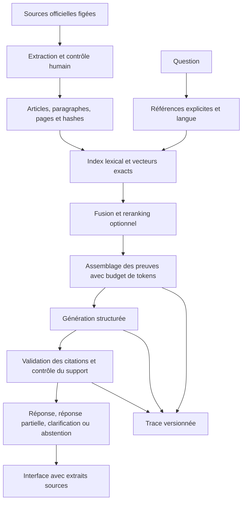

# Spécification technique

[Accueil](README.md) · [Planning](roadmap.md) · [Évaluation](evaluation-protocol.md)

Les chemins et commandes ci-dessous décrivent le **futur dépôt**. Ils ne désignent pas des composants déjà implémentés dans SearchBench.

## 1. Contrat du produit

### Fonctionnement attendu

L'utilisateur pose une question en français. Le système :

1. Identifie une référence explicite à un article et la langue de la question.
2. Recherche les passages utiles dans une édition déterminée du corpus.
3. Sélectionne un ensemble de preuves qui tient dans le budget du modèle.
4. Produit une réponse structurée avec des références au niveau des affirmations.
5. Contrôle les identifiants, les extraits et leur correspondance avec les sources.
6. Répond, répond partiellement, demande une précision ou s'abstient.
7. Affiche les sources et enregistre une trace exploitable pour l'évaluation.

La portée affichée est « réponse documentaire à partir de l'édition X ». Une question sur la législation actuelle, un litige personnel, une jurisprudence absente ou un texte d'application non ingéré peut dépasser ce périmètre. L'absence d'information dans le corpus ne prouve pas l'absence d'une règle dans le droit marocain.

### Scénarios de démonstration

- Retrouver et expliquer un article explicitement nommé.
- Retrouver un principe exprimé avec des mots différents du texte source.
- Comparer deux mécanismes à partir de plusieurs passages.
- Corriger une prémisse contredite par un passage précis.
- Demander une clarification lorsque la question désigne une institution de manière ambiguë.
- Dire qu'une procédure ou un délai n'est pas déterminable à partir de ce corpus.
- Résister à une instruction malveillante insérée dans un document de test.

Les questions définitives et leurs réponses devront être vérifiées dans les sources ; ces scénarios ne sont pas des réponses juridiques préétablies.

## 2. Architecture



Le parcours « texte intégral » contourne D/F mais conserve la même génération, les mêmes identifiants de sources et les mêmes contrôles. Le parcours oracle utilise les preuves annotées uniquement pour diagnostiquer les erreurs ; il n'est pas disponible aux utilisateurs.

## 3. Corpus et provenance

### Source principale et sources de contrôle

**Entrée : un PDF officiel de référence, sélectionné dans [Sources PDF](sources.md).** Commencer en français avec la Constitution de 2011, version la plus récente identifiée dans les sources institutionnelles consultées. Conserver le fichier tel quel, calculer son hash et consigner son origine. Déterminer son édition, son nombre de pages et s'il contient une couche texte exploitable. L'extraction, le nettoyage et le découpage du PDF font partie intégrante du nouveau projet.

Si le PDF est scanné ou mixte, appliquer l'OCR seulement aux pages qui le nécessitent et conserver les images originales, les versions des outils et les scores de confiance disponibles. Une confiance OCR élevée ne dispense pas de vérifier les numéros d'articles, les négations et les nombres. Les pages en colonnes, notes, en-têtes, pieds de page et césures demandent des règles testées séparément.

Point de départ français : [Constitution, édition 2011, SGG](https://www.sgg.gov.ma/Portals/0/constitution/constitution_2011_Fr.pdf). Autre téléchargement officiel confirmé : [PDF lié par Maroc.ma](https://maroc.ma/sites/default/files/2024-10/constitution_du_1er_juillet_2011.pdf). Le premier a été identifié par recherche, mais son ouverture complète a expiré ; le second a été ouvert comme PDF de 28 pages. J1/J2 vérifieront le fichier choisi, sa langue et sa couche texte avant ingestion.

Une deuxième publication institutionnelle peut servir à contrôler des anomalies d'extraction, en vérifiant qu'il s'agit de la même édition et de la même version linguistique. Une correction reste documentée ; une différence entre traductions ou éditions n'est pas une erreur d'OCR.


Définir une politique de redistribution avant de publier les PDF. Si nécessaire, publier seulement le script d'acquisition, les métadonnées, les hashes et les annotations dont la redistribution est autorisée.

### Trois couches de texte

1. **Original brut** : fichier immuable, hash SHA-256, URL et date de récupération.
2. **Texte canonique** : extraction relue, espaces et césures corrigés avec journal des corrections ; c'est le texte utilisé pour les offsets de citation.
3. **Texte de recherche** : normalisation spécifique au moteur et à la langue. Il ne remplace jamais le texte affiché.

Une référence de page utilise explicitement un index physique du PDF à partir de 1 et, séparément, le numéro imprimé s'il existe.


### Entités minimales

| Entité | Champs nécessaires |
| --- | --- |
| `SourceDocument` | `source_id`, `edition_id`, `language`, `source_url`, `retrieved_at`, `sha256`, `page_count`, `parser_version` |
| `Article` | `article_id`, `source_id`, `article_number`, `title_path`, `canonical_text`, `page_spans`, `text_hash` |
| `Passage` | `passage_id`, `article_id`, `paragraph_index`, `char_start`, `char_end`, `canonical_text`, `index_text`, `token_count` |
| `ReferenceEdge` | `from_article`, `to_article`, `reference_quote`, `edge_type`, `review_status` |
| `RetrievalHit` | `passage_id`, `rank`, `score`, `retriever`, `index_version` |
| `EvidenceSpan` | `passage_id`, `char_start`, `char_end`, `quote`, `source_hash` |
| `Claim` | `claim_id`, `text`, `evidence_spans`, `support_status`, `verification_method` |
| `Answer` | `status`, `claims`, `limitations`, `clarification_question`, `run_id` |

Un identifiant doit inclure l'édition et la langue, par exemple `ma-constitution-2011:fr:art-N:p-M`. `N` et `M` sont des emplacements, pas des articles proposés comme preuves. Préambule et autres unités non numérotées ont leurs propres identifiants.

Les offsets sont des indices de caractères Unicode dans le **texte canonique du passage**, intervalle `[start, end)`. Le hash permet de détecter un extrait devenu incompatible après correction. Les coordonnées PDF, si ajoutées pour surligner le document original, nécessitent une table de correspondance distincte.

### Réponse et erreurs

`Answer.status` appartient à : `answered`, `partially_answered`, `needs_clarification`, `insufficient_evidence`, `out_of_scope`.

Une panne technique est un objet d'erreur distinct : `provider_timeout`, `budget_exceeded`, `invalid_output`, `source_unavailable`. Ne pas compter une panne comme une bonne abstention documentaire.

Chaque affirmation factuelle de la réponse est rendue depuis `claims`. Une introduction libre ne doit pas permettre d'ajouter des faits non vérifiés. Les clarifications et messages techniques restent distingués des affirmations documentaires.

## 4. Modules à implémenter

### Ingestion

- Acquisition du PDF de référence avec délais d'attente, vérification du type de fichier et hash ; import local possible du même document.
- Extraction page par page, segmentation en articles puis paragraphes.
- Diagnostic couche texte/image par page ; OCR ciblé si nécessaire ; contrôle du sens de lecture et des ligatures.
- Suppression contrôlée des en-têtes/pieds de page répétitifs, réparation des césures et espaces, préservation des notes qui changent le sens.
- Inventaire des numéros attendus établi depuis le document ; signalement des doublons et manques.
- Journal des réparations manuelles, et comparaison ancien/nouveau corpus.
- Traçabilité de chaque passage vers la page du PDF initial, même après nettoyage ; aucun article ne disparaît silencieusement.
- Reconstruction atomique : valider un nouveau corpus/index avant de remplacer la version active.

### Retrieval

- Accès direct aux références du type « article X », avec validation de leur existence.
- BM25, puis embeddings multilingues avec recherche exacte et scores reproductibles.
- Fusion RRF avec profondeurs distinctes : `lexical_k`, `dense_k`, `fusion_k`, `rerank_k`, `context_k`.
- Règle stable pour les ex æquo ; déduplication des passages et des articles pour les métriques.
- Reranker optionnel, évalué sur des candidats identiques à ceux de sa baseline.
- Stratégies comparables : article entier, paragraphes, paragraphes avec rappel du parent.

Le petit corpus ne justifie pas initialement un index approximatif. Une bibliothèque mature peut servir de backend BM25 : tu as déjà étudié son implémentation dans SearchBench. Tout code réutilisé de SearchBench doit passer ses tests de contrat avant intégration.

### Assemblage des preuves

- Limite en tokens mesurée avec le tokenizer ou le compteur du fournisseur.
- Réservation du budget de sortie et des instructions ; pas de troncature silencieuse.
- Déduplication et conservation des paragraphes nécessaires pour comprendre les exceptions.
- Extension d'au plus un saut sur les **renvois explicites vérifiés**, avec plafond de passages.
- Décomposition optionnelle en deux ou trois sous-questions ; fusion des preuves et nombre d'appels borné.
- Trace complète des passages candidats, rejetés et finalement envoyés au modèle.

Un graphe de renvois explicites ne représente pas toutes les relations juridiques. Une relation proposée par un modèle doit porter une provenance différente et ne devient pas une règle de droit.

### Génération et vérification

- Adaptateur `Generator` indépendant du fournisseur ; commencer avec Gemini Flash disponible au moment de l'implémentation.
- Identifiant exact du modèle, version du SDK et paramètres enregistrés. Si seul un alias mutable existe, le signaler.
- Schéma de sortie structuré. Les [sorties structurées Gemini](https://ai.google.dev/gemini-api/docs/structured-output) permettent de demander un JSON conforme à un schéma ; cela ne démontre pas la vérité des valeurs.
- Citations locales : IDs issus du corpus, extraits contrôlés par le serveur, URL reconstruite depuis les métadonnées. Ne pas faire confiance à une URL inventée par le modèle.
- Validateur déterministe : ID autorisé, bon hash, offsets valides, extrait exact, source effectivement fournie.
- Contrôle sémantique séparé : l'extrait justifie-t-il l'affirmation ? Étiquette `supported`, `contradicted`, `insufficient`, `uncertain`.
- Un vérificateur LLM/NLI peut aider, mais son taux d'erreur est mesuré face à des annotations humaines. Son accord avec le générateur ne suffit pas.
- Au plus une tentative de réparation ; après échec, réponse partielle ou abstention documentée.

### Politique d'abstention

Combiner des signaux disponibles en production : absence de référence explicite, score/marge de retrieval, diversité des preuves, validité structurelle, verdict du vérificateur. Un score de reranking, même transformé par sigmoid, n'est pas une probabilité calibrée de vérité.

Choisir les seuils sur validation et comparer au moins : réponse systématique, seuil simple, politique avec vérification. En cas de preuves partielles, conserver les seules affirmations supportées et expliciter la partie non déterminable.

### Service et interface

- API de type `POST /ask`, `GET /sources/{id}`, `GET /health` et `GET /version`.
- FastAPI ou équivalent déjà maîtrisé ; une interface légère suffit.
- Vue question/réponse, citations cliquables, extraits exacts, article, langue et édition visibles.
- Retour utilisateur « incorrect », « source inadéquate », « information manquante », stocké sans modifier automatiquement les labels du benchmark.
- Résultats partiels : ne pas diffuser des affirmations avant leur validation sous un statut trompeur « vérifié ».

### Exécution fiable

- Timeout, reprises limitées avec backoff, interruption propre et checkpoint par question.
- Cache basé sur corpus, question, passages, modèle, prompt, paramètres et configuration de vérification.
- Traçage des tokens d'entrée/sortie, cache fournisseur, appels, coûts estimés et latences par étape.
- Quotas et plafond de dépense ; clés dans l'environnement, jamais dans les notebooks ou traces.
- Pour une démo publique : entrées bornées, limitation du débit, aucune URL utilisateur téléchargée automatiquement, pas de clés côté navigateur.
- Échapper HTML/Markdown dans les extraits et réponses ; documents traités comme données, sans outil d'exécution.

## 5. Organisation du futur dépôt

```text
constitution-evidence/
  pyproject.toml
  <lockfile>
  README.md
  PROJECT_LOG.md
  .env.example
  configs/
    corpus.yaml
    retrieval.yaml
    generation.yaml
    evaluation.yaml
  src/constitution_evidence/
    schemas.py
    ingestion/
    retrieval/
    evidence/
    generation/
    verification/
    evaluation/
    api/
    cli.py
  tests/
    unit/
    integration/
    regression/
    fixtures/              # petit corpus fictif pour les tests hors ligne
  data/
    manifests/             # versionné
    annotations/           # versionné selon politique de test/publication
    raw/                   # acquisition contrôlée
    processed/
  runs/<run_id>/
    manifest.json
    retrieval.jsonl
    responses.jsonl
    judgments.jsonl
    metrics.json
    errors.jsonl
  app/
  reports/
  docs/
    data-card.md
    annotation-guide.md
    threat-model.md
    limitations.md
```

### Commandes cibles à rendre exécutables

```bash
python -m constitution_evidence.cli ingest --config configs/corpus.yaml
python -m constitution_evidence.cli validate-corpus
python -m constitution_evidence.cli index --config configs/retrieval.yaml
python -m constitution_evidence.cli evaluate --split dev --config configs/evaluation.yaml
python -m constitution_evidence.cli report --run-id RUN_ID
python -m constitution_evidence.cli serve
```

Le mode test final doit demander une configuration figée et produire un manifeste. `report` ne doit pas appeler le fournisseur ; il recalcule les agrégats depuis les artefacts sauvegardés.

## 6. Choix de modèles et budget

Premiers candidats documentés, sans présumer du gagnant :

- [Multilingual E5 small](https://huggingface.co/intfloat/multilingual-e5-small) pour la première recherche dense. Respecter notamment ses préfixes `query:` et `passage:` et mesurer la troncature.
- [BGE reranker v2 m3](https://huggingface.co/BAAI/bge-reranker-v2-m3) comme candidat multilingue de reranking. Mesurer mémoire/latence sur ta machine avant de retenir cette option.
- Un modèle Gemini Flash accessible dans ton compte, sélectionné après un pilote de qualité, coût et disponibilité ; identifiant exact enregistré à chaque run.

Figer les révisions des poids et les dépendances effectivement testées. Une alternative plus petite reste acceptable si elle répond mieux au budget. Ne pas installer trois frameworks RAG pour faire la même orchestration.

### Budget expérimental

Commencer par 10 à 20 requêtes. Enregistrer les unités réellement facturables. Estimer :

`coût = tokens_entrée × tarif_entrée + tokens_sortie × tarif_sortie + autres frais applicables`

Séparer contexte mis en cache, éventuels tokens de raisonnement et appels au vérificateur selon le fournisseur. Consulter les tarifs au moment des runs. Exemple de **plafond choisi**, non estimation garantie : 30 € pour le premier cycle, avec arrêt automatique avant dépassement ; réduire les configurations si le pilote montre que cela ne suffit pas.

L'annotation constitue une part majeure du travail : prévoir environ 25 à 45 heures pour le benchmark français et une relecture indépendante. Aucun reviewer n'est présumé disponible ; documenter le niveau réel de validation.


## 7. Tests de contrat prioritaires

| Cas | Résultat attendu |
| --- | --- |
| Numéro d'article manquant ou dupliqué après extraction | Échec de validation avec localisation |
| Réindexation du même corpus | Même contenu logique, sans duplication |
| Nouveau corpus après un ancien | Aucun résultat issu d'une version inactive |
| Passage vide, question vide, `k <= 0` | Réponse d'erreur définie, pas d'exception obscure |
| Même article en plusieurs chunks | Métrique article sans double comptage |
| Pertinent uniquement au rang 11 | MRR@10 égal à zéro |
| ID inexistant ou extrait modifié | Citation rejetée |
| Extrait exact mais sans rapport | Validité syntaxique vraie, support sémantique faux |
| Preuves partielles | Réponse partielle, pas d'affirmation complète inventée |
| JSON invalide après réparation | Erreur/abstention explicite, trace conservée |
| API indisponible | Retry borné puis erreur distincte de l'abstention |
| Interruption après 12 requêtes | Reprise sans perdre ou doubler les 12 réponses |
| Prompt ou corpus modifié | Ancien cache non réutilisé silencieusement |
| Instruction dans un passage | Aucune exécution ni divulgation de secret |

## 8. Conditions de livraison

Une autre personne peut installer le projet, lancer les tests hors ligne, reproduire les agrégats publiés et poser une question avec sa propre clé. Une comparaison texte intégral/BM25/RAG avancé est publiée avec ses limites. Le README indique le corpus précis, les langues réellement évaluées, les coûts observés et les cas non pris en charge.

Les sources externes ci-dessus servent à définir les entrées et les interfaces. Les choix d'architecture, de benchmark et de seuils de la feuille de route sont des propositions à tester, pas des garanties fournies par ces sources.
